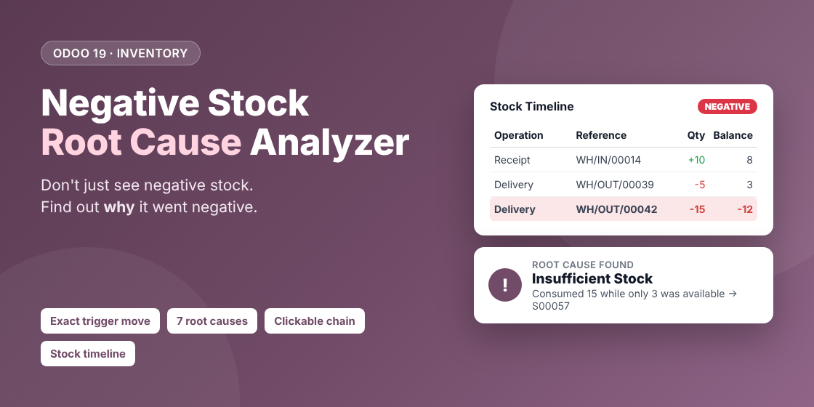
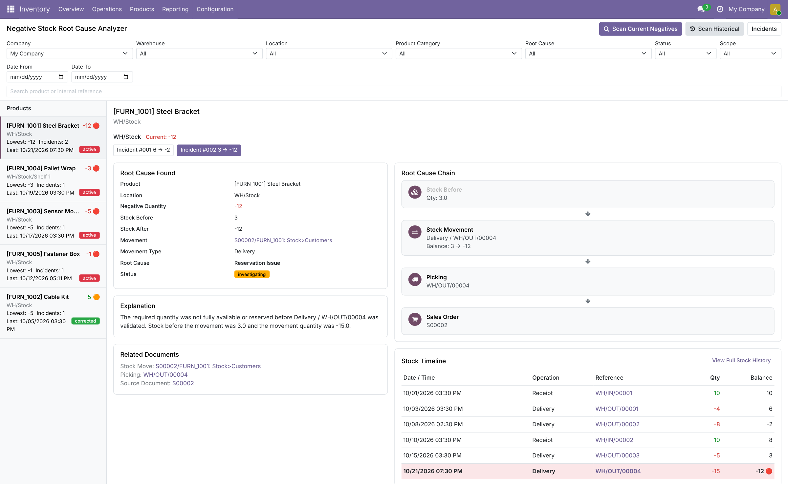

# Inventory Negative Stock Root Cause Analyzer

**Odoo 19** · Category: Warehouse · License: OPL-1 · Price: €159

Odoo tells you a product **is** negative. This module tells you **why**.

It goes back through each product's stock movement history, location by location. It finds the exact movement that took the balance from `>= 0` to `< 0` and decides the root cause. It then links you straight to the stock move, the picking and the source document (sales, purchase or manufacturing order).

---

## Features

- **Analyzer dashboard**: an interactive screen under *Inventory → Reporting → Negative Stock Analyzer*.
- **Exact trigger movement** for each incident: stock before, movement quantity, stock after and the negative quantity.
- **Root cause classification** with a plain-language explanation.
- **Clickable root cause chain**: Stock Before → Stock Movement → Picking → Source Document → Related Moves.
- **Stock timeline** showing the moves just before and after the trigger, each with its running balance.
- **Multiple incidents per product**: each time the stock goes negative is a separate incident (`Incident #001`, `#002`, …).
- **History is kept**: incidents later fixed by a receipt are marked *Corrected* with the date it happened.
- **Filters**: company, warehouse, location, product category, root cause, status, current or historical, date range and product search.
- **Incidents report**: a list and form view with search filters, group-by options and a chatter.
- **Scheduled incremental scan**: runs daily and can be turned off in Settings.
- **Read-only**: it never validates pickings, changes reservations, edits quantities or creates adjustments.

---

## How it works

1. **Scan**: *Scan Current Negatives* checks the locations that are negative right now. *Scan Historical* goes through all done moves, so it also finds negatives that were later corrected.
2. **Replay**: for each product and internal location, done `stock.move` records are processed in date order and a running balance is kept.
3. **Detect**: every time the balance goes from `>= 0` to `< 0`, an incident (`NSA/xxxxx`) is created.
4. **Classify**: the move that caused it is checked to find the root cause (see the table below).
5. **Recover**: when a later move brings the balance back to `>= 0`, the incident is marked **Corrected**.

All analysis runs on the server. The dashboard only loads the product and incident you select.

### Root cause types

The checks run in this order, and the first one that matches sets the root cause.

| Root cause | Detected when | Initial status |
|---|---|---|
| Inventory Adjustment | The move goes from or to an *Inventory* type location | Active |
| Transfer Issue | An internal transfer moved out more than the location held | Active |
| Sequence / Timing Issue | Stock went out before a receipt that followed shortly after | Active |
| Reservation Issue | The demand was more than the stock available and the forecast shows it wasn't fully reserved | Investigating |
| Insufficient Stock | The move used more than the available balance | Active |
| Manual / Unidentified Movement | The move isn't linked to a picking | Unknown |
| Unknown | There isn't enough information to name a more specific cause | Unknown |

---

## Installation

1. Copy `sh_inventory_negative_stock_analyzer` into your addons path.
2. Restart Odoo and update the Apps list (*Apps → Update Apps List*, in developer mode).
3. Search for **Inventory Negative Stock Root Cause Analyzer** and click **Install**.

**Dependencies:** `stock`, `mail`. Sales, purchase and manufacturing orders show in the chain automatically when those apps are installed.

---

## Configuration

*Inventory → Configuration → Settings → Negative Stock Analyzer*

| Setting | Default | Description |
|---|---|---|
| Timeline Window | 5 | How many moves to show before and after the move that caused the incident |
| Automatic Incremental Scan | Enabled | Turns on the daily scheduled action *Negative Stock Analyzer: Incremental Scan* |

---

## Usage

1. Open **Inventory → Reporting → Negative Stock Analyzer**.
2. Run **Scan Historical** once to analyze your existing history. After that, **Scan Current Negatives** is enough for quick refreshes.
3. Select a product and location on the left, then select an incident.
4. Review the **Root Cause Found** summary, the **Explanation**, the **Root Cause Chain** and the **Stock Timeline**.
5. Click any document to open its standard Odoo form and fix it the usual way.
6. Use **View Full Stock History** to see every move for that product and location.

You can also list and group all incidents under **Inventory → Reporting → Negative Stock Incidents**.

---

## Security

| Group | Access |
|---|---|
| Inventory / User | Dashboard and incidents: read, write and create |
| Inventory / Administrator | Everything, plus delete and settings |

- Multi-company record rules limit what each user sees to their allowed companies.
- Linked documents only appear in the chain when the user can read them.

---

## Technical overview

| Model | Purpose |
|---|---|
| `inventory.negative.stock.incident` | One record for each time the balance went negative (trigger move, quantities, root cause, chain and timeline) |
| `inventory.negative.stock.product` | One dashboard row per product, location and company (current and lowest quantity, incident count, status) |
| `res.config.settings` | Timeline window and auto-scan settings |

- **Frontend:** OWL client action `sh_inventory_negative_stock_analyzer.dashboard` with a `RootCauseChain` component.
- **Scheduled action:** `model._cron_scan_negative_stock()`, daily.
- **Sequence:** `NSA/00001`.
- **Tests:** `tests/test_negative_stock_analyzer.py`.

---

## Testing tips

- To reproduce live negatives, allow negative stock on the product or warehouse, then validate a delivery for more than is on hand.
- Historical incidents stay visible after a later receipt corrects the quantity.

---

## Support

For help or customizations, use the **Support** contact on the module's Odoo Apps page.

## Changelog

See [`doc/changelog.rst`](doc/changelog.rst).
